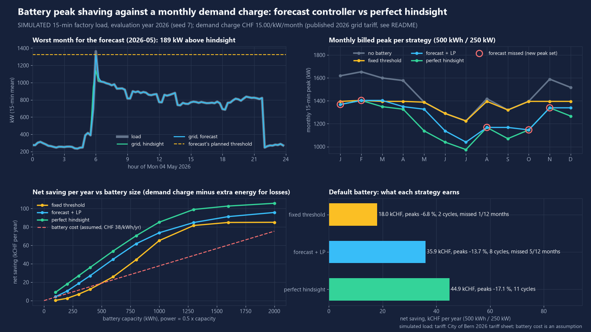
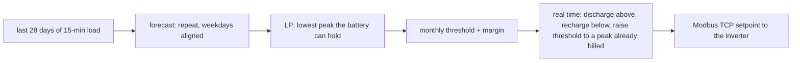

# peak-shaving-controller

On a simulated factory with a 500 kWh / 250 kW battery, a forecast + LP controller saved CHF 35 900 a year in demand charges: 80 % of the perfect-hindsight optimum (CHF 44 900) and twice a fixed-threshold rule (CHF 18 000).



## What it does

Battery peak shaving for an industrial site that pays a **demand charge**: CHF per kW of the highest 15-min mean power in each month. One bad quarter hour sets the bill for the whole month, so the battery only has to be there for a few intervals, but it has to be there every time.

Four strategies, same battery model, same simulated year:

| strategy | how it decides | tuned on |
|---|---|---|
| `none` | no battery | - |
| `fixed` | one grid-power threshold for the year; discharge above it, recharge below it (never above it) | the best single threshold on the previous year |
| `forecast` | at the start of each month: forecast = the last 28 days repeated (weekdays aligned); a linear programme (scipy/HiGHS) finds the lowest peak the battery could hold on that forecast; threshold = that peak + margin. During the month: the same rule as `fixed`, and once a peak above the threshold is billed anyway, the threshold rises to it (no energy wasted shaving below a peak already paid for) | margin chosen on the previous year (it came out at 0) |
| `hindsight` | the same LP on the real load of the whole year, all 12 monthly peaks at once | it knows the future: an upper bound, not a controller |

- **Load**: seeded generator of a 15-min factory load (`peak_shaving/load.py`): two weekday shifts, some Saturday shifts, start-up spikes, random coincident loads, heat pumps below 15 C and chillers above 20 C from a synthetic outdoor temperature, public holidays, a summer and a Christmas shutdown, AR(1) noise. 2025 is the "history" year (tuning only), 2026 is the evaluation year.
- **Battery model** (`peak_shaving/battery.py`): capacity, AC power limit, 90 % round-trip efficiency split between charge and discharge, SoC kept between 10 % and 90 %, starts full.
- **Report** per strategy: peak cut (sum of the 12 billed peaks), CHF per year of demand-charge saving, extra energy cost of battery losses, net saving, equivalent full cycles per year, and the share of months the controller **missed** (the billed peak went above the threshold it planned for that month).
- **Battery size sweep** 100-2000 kWh at 0.5C, with the extra saving per extra kWh against an assumed battery cost, to show where extra kWh stops paying.
- **Your own data**: `python -m peak_shaving evaluate load.csv --kwh 500` runs the strategies on a 15-min CSV (`time`, `load_kw`; gaps and negative values are rejected).
- **Modbus TCP** (optional extra, `peak_shaving/modbus.py`): a generic register map for a battery inverter (setpoint, mode, heartbeat; SoC, power, limits, energy counter, state), a simulated inverter that serves it with pymodbus, a client, and a heartbeat watchdog that drops the inverter to 0 kW when the controller goes silent.

## Results

All measured by `python -m peak_shaving demo` on the **simulated** load (seed 7, evaluation year 2026: 4 566 MWh, mean 521 kW, monthly peaks 1 224-1 653 kW). Demand charge CHF 15.00/kW/month; battery losses charged at CHF 0.1988/kWh. Full tables: `docs/results.md`, raw: `docs/results.json`.

**Default battery 500 kWh / 250 kW**

| strategy | billed peaks cut | demand saving CHF/yr | extra energy CHF/yr | net CHF/yr | cycles/yr | missed months |
|---|---|---|---|---|---|---|
| fixed threshold (1 395 kW) | 6.8 % | 17 981 | 18 | **17 964** | 2.0 | 1/12 |
| forecast + LP | 13.7 % | 36 018 | 70 | **35 948** | 7.9 | 5/12 |
| perfect hindsight | 17.1 % | 45 000 | 96 | **44 904** | 10.9 | - |

The fixed threshold is set for the winter peaks. In May, June, July and September the load never reached it and the battery saved nothing; in October it saved 1 kW. It cut the annual maximum as much as the others (15.1 %), but the bill is monthly.

**Where the forecast loses to hindsight, and why** (CHF 8 982/yr of demand charge, per month in `docs/results.md`):

- All of the gap comes from the 7 months in which it **held** its threshold, but that threshold was higher than needed. The forecast is "the last 28 days again", so when the peak falls from one month to the next (March to July, September, December) it plans for last month's level. May alone costs CHF 2 831: the plan was 1 327 kW, hindsight managed 1 138 kW.
- The 5 **missed** months cost **nothing** against hindsight at this size. Each followed a quieter month: January and August were planned from the Christmas and summer breaks, February, October and November from milder weeks. In all of them the month's peak was a Monday 06:00 start-up spike on a cold morning, and even hindsight could take only 250 kW (the inverter limit) off it: both end at the load peak minus 250 kW. After the miss, raising the threshold to the peak that is already billed keeps the rest of the month at that level.
- So the weak point is that a 28-day look-back trails the season. Fixing it needs a seasonal or weather-aware forecast, which this repo does not have.

**Battery size sweep** (power = 0.5 x capacity, net saving CHF/yr):

| kWh | 100 | 200 | 400 | 600 | 800 | 1 000 | 1 300 | 1 600 | 2 000 |
|---|---|---|---|---|---|---|---|---|---|
| fixed | 273 | 2 415 | 12 334 | 25 792 | 44 403 | 65 150 | 81 613 | 84 893 | 85 085 |
| forecast + LP | 4 162 | 10 339 | 26 978 | 44 903 | 61 793 | 73 683 | 84 821 | 91 254 | 95 751 |
| hindsight | 8 995 | 17 985 | 35 944 | 53 845 | 70 480 | 85 164 | 99 046 | 102 729 | 105 721 |
| forecast cycles/yr | 1.9 | 2.8 | 5.6 | 10.8 | 20.3 | 32.6 | 53.1 | 60.1 | 63.7 |

Up to about 600 kWh the hindsight saving grows by CHF 90 per extra kWh per year. That is the power limit: each kWh brings 0.5 kW, and 0.5 kW x CHF 15 x 12 months = CHF 90. The monthly peaks here are short spikes, so more kW pays straight away. Above about 800 kWh the peaks left are broad production plateaus that need energy, and the extra saving per kWh falls: 46, 12, then 7.5 CHF/yr for hindsight.

At an **assumed** installed cost of CHF 450/kWh over 15 years at 3 % (CHF 37.7 per kWh per year), extra kWh stop paying above **1 000 kWh** for the forecast controller (1 000 -> 1 300 kWh earns CHF 37.1 per extra kWh per year) and above 1 300 kWh for hindsight. The best swept size (net saving minus annualized cost) is 1 000 kWh for the forecast controller (CHF 35 988/yr) and 1 300 kWh for hindsight (CHF 50 042/yr). These cost lines are only as good as the cost assumption.

**Robustness** (5 other seeds, 500 kWh / 250 kW): forecast + LP net CHF 36 331-38 507/yr (mean 37 599, 6.8 missed months on average), hindsight CHF 44 893-44 923, fixed threshold CHF 11 544-24 110. The fixed rule depends most on how the history year happened to look.

## Quick start

```bash
uv venv .venv --python 3.12
uv pip install --python .venv/Scripts/python.exe -e ".[dev]"     # Linux/macOS: .venv/bin/python
.venv/Scripts/python.exe -m peak_shaving demo                    # all results + figures into docs/ (about 10 min)
.venv/Scripts/python.exe -m peak_shaving demo --quick --no-figures --out results/quick   # 2 sizes, no seeds (CI)
.venv/Scripts/python.exe -m peak_shaving simulate --out load.csv  # the simulated load as CSV
.venv/Scripts/python.exe -m peak_shaving evaluate load.csv --kwh 500 --threshold 1400   # your own 15-min load
.venv/Scripts/python.exe -m peak_shaving tariff                  # tariff values and source
.venv/Scripts/python.exe -m peak_shaving modbus-sim --port 5020  # simulated inverter on Modbus TCP
.venv/Scripts/python.exe -m pytest -q
```

A plain `python -m venv` + `pip install -e ".[dev]"` works too. pymodbus is only needed for the Modbus part (`.[modbus]`).

## How it works



**LP** (`peak_shaving/lp.py`): variables charge, discharge and SoC per 15-min interval plus one peak per month. It minimizes the sum of (CHF/kW/month x monthly peak) plus the energy cost of grid import. Constraints: power limits, SoC limits, SoC dynamics with charge and discharge efficiency, no export, and the battery ends at least as full as it started, so it gets no free energy from the initial charge. A full year is about 105 000 variables and solves in about 10 s with HiGHS.

**Fair comparison**: the fixed threshold and the forecast margin are picked on the 2025 simulated year only, and every number above is measured on 2026. Hindsight solves 2026 knowing 2026, so it is the bound, not a rival.

## Data sources

- **Demand charge**: City of Bern, Gemeinderat, "Stromtarife 2026 im Ueberblick". This is the tariff table attached to the city's press release "Anpassung der Stromtarife fuer 2026" of 28 Aug 2025 (PDF dated 27 Aug 2025): https://www.bern.ch/mediencenter/medienmitteilungen/aktuell_ptk/anpassung-der-stromtarife-fuer-2026/dokumente/tabelle-stromtarife-2026.pdf/download. Opened and read for this project in November 2026. Value used: grid-use tariff "Professional", Leistungstarif **CHF 15.00/kW/month** in 2026 (same as 2025). The "Business" group (above 50 000 kWh/a) pays CHF 18.00/kW/month on the same sheet; `evaluate --price 18` reruns with it.
- **Energy price for losses**: the 2026 rows of the same sheet for a "Professional" medium-voltage customer at the normal tariff, in Rp./kWh: grid 2.05 + energy (basic product, normal tariff) 13.40 + system services 0.27 + federal reserve 0.41 + solidarity 0.05 + municipal levy 1.40 + federal grid surcharge 2.30 = 19.88 Rp./kWh.
- **Load, outdoor temperature, battery behaviour**: **simulated**, seeded, all parameters are assumptions (`peak_shaving/load.py`, `peak_shaving/config.py`).
- **Battery cost** (size sweep only): assumption, CHF 450/kWh installed, 15 years, 3 %. Not a quote.

## What is not verified yet

- Nothing has run on a real site, a real meter or a real battery. All load data is simulated; a real factory has other spikes, other seasons and other surprises.
- The tariff sheet does not say how the billed power is measured. The 15-min monthly maximum is an assumption. It also does not say which customers count as "Professional"; whether a given factory is billed CHF 15 or 18 per kW is not checked.
- Not modelled: battery ageing and its cost per cycle, standby and auxiliary consumption, inverter ramp rates and communication delays, reactive power, high/low tariff time windows (losses are all priced at the normal rate), and the grid operator's own rules for batteries.
- The forecast is deliberately simple: no weather forecast, no production plan, no holiday calendar. A better forecast would close part of the CHF 8 982 gap; how much is not measured.
- The "reason" given for a missed month (random coincident load or load above the last 28 days) is a heuristic on the simulated event log.
- The Modbus register map is this project's own generic map. It is tested only against its own simulated inverter, not against any real inverter.

## Licence

MIT, Copyright (c) 2026 Victor Bonilla. See `LICENSE`.
